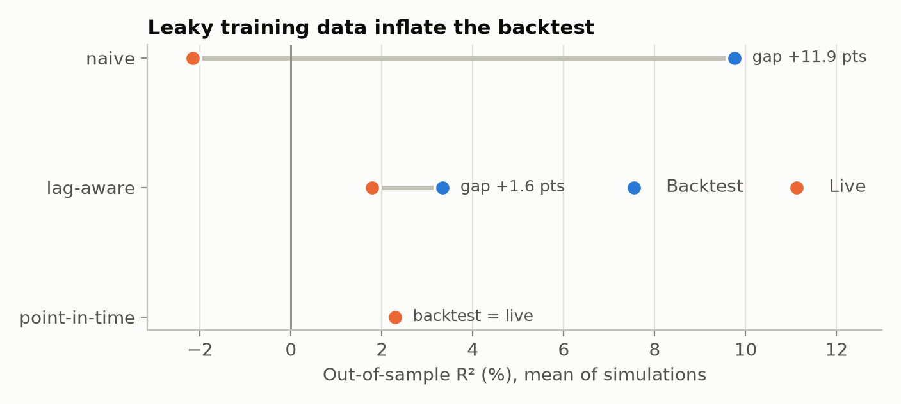
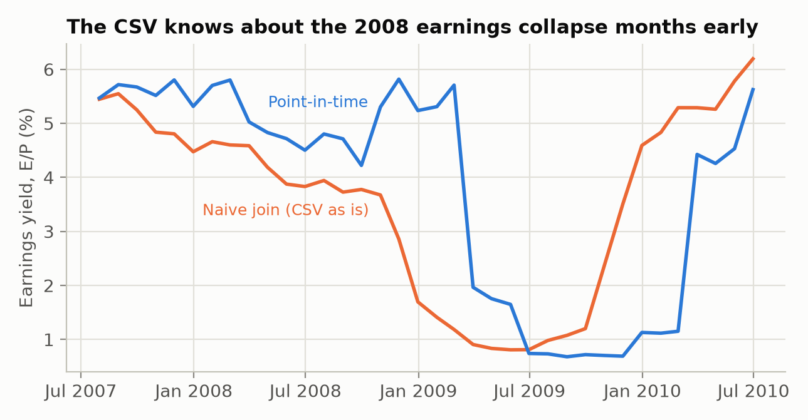

# pitstore

[](https://github.com/Pearmaleka/pitstore/actions/workflows/ci.yml)

A point-in-time feature store on DuckDB. It keeps every published version of every observation
and joins features to training rows using only what was known at each row's timestamp.

Most datasets are stamped with the period a number describes, not the day it became public. Q1
GDP growth is first published in late April and revised twice over the next two months. A file of
final values puts the third estimate in the row for March 31, so a model trained on it sees
numbers that did not exist when the decision was made. pitstore stores the release history and
answers "what did we know at time t?" with a single join.

## Quick start

```bash
pip install "git+https://github.com/Pearmaleka/pitstore"
```

```python
import pandas as pd
from pitstore import FeatureStore

releases = pd.DataFrame(
    {
        "quarter_end": ["2024-03-31", "2024-03-31", "2024-03-31", "2024-06-30", "2024-06-30"],
        "published": ["2024-04-25", "2024-05-30", "2024-06-27", "2024-07-25", "2024-08-29"],
        "gdp_growth": [1.6, 1.3, 1.4, 2.8, 3.0],
    }
)
store = FeatureStore("macro.duckdb")
store.ingest(
    "gdp_growth", releases, event_time="quarter_end", value="gdp_growth", available_at="published"
)
# gdp_growth: 5 rows inserted, 0 already stored, 0 dropped (missing values) out of 5

decisions = pd.DataFrame({"ts": pd.to_datetime(["2024-05-01", "2024-07-01", "2024-09-01"])})
store.as_of(decisions, ["gdp_growth"], metadata=True)
```

```
          ts  gdp_growth gdp_growth__event_time gdp_growth__available_at
0 2024-05-01         1.6             2024-03-31               2024-04-25
1 2024-07-01         1.4             2024-03-31               2024-06-27
2 2024-09-01         3.0             2024-06-30               2024-08-29
```

On May 1 only the advance estimate was out. By July 1, Q1 had been revised twice and Q2 had not
been published. `mode="naive"` gives the usual event-time join instead, and returns 1.4 on May 1:
a number published eight weeks later.

The same operations from the shell:

```bash
pitstore ingest macro.duckdb gdp_growth releases.csv --event-time quarter_end \
    --value gdp_growth --available-at published
pitstore asof macro.duckdb decisions.csv --features gdp_growth --time ts -o train.csv
pitstore snapshot macro.duckdb gdp_growth --as-of 2024-06-01   # the series as of a date
pitstore describe macro.duckdb                                 # coverage, lags, revisions
pitstore check macro.duckdb --stale-days 120                   # exit code 1 on problems
```

## Features

- **Bitemporal storage.** Each value has an `event_time` (the period it describes) and an
  `available_at` (when it was published). A revision is a new row; nothing is overwritten.
- **Point-in-time joins** for any number of entities and features: `as_of(spine, features)`,
  with an optional `max_age` and the event and publication time of every value.
- **Release calendars** for data without publication dates: `fixed_lag`, `business_days`,
  `monthly_release(day)` and `after_quarter_end(days)`.
- **Safe ingestion.** Loading the same file twice changes nothing. A batch that would change a
  stored value is rejected as a whole, as are values published before their event time.
  Time-zone-aware timestamps are converted to UTC.
- **Snapshots** (`snapshot(name, as_of)`), full revision **history**, a `describe()` summary and
  data-quality **checks** for gaps, late releases, outlying revisions and stale series.

## How the join works

At time *t* the answer for an entity is the latest event published by *t*, in its latest version
published by *t*. A plain as-of join on `available_at` gets this wrong: if a revision of an old
quarter is published after the first release of a new quarter, it would return the old quarter.

pitstore sorts each entity's rows by `available_at` and keeps a running maximum of `event_time`.
Only rows that reach the running maximum can ever be an answer; revisions of older events never
can. Those rows form a `timeline` table, and the query is one `ASOF LEFT JOIN` against it. The
timeline is updated inside the ingest transaction, for the entities a batch touches and only
from the batch's earliest publication time onwards.
[docs/design.md](docs/design.md) has the schema, the argument for correctness and the
alternatives that were tried.

## Results

### 1. Revised data inflate a backtest (simulation)

A monthly indicator *x* (AR(1), φ = 0.6) explains 10% of the variance of next month's return.
Like GDP, it is published 15 days after the month with noise (sd 0.6), revised at 45 days
(sd 0.3) and final after 400 days. A linear model is trained on 20 years and tested on the next
20, 500 times. "Backtest" scores each model on its own kind of features; "live" scores the same
model on the point-in-time features it would get in production.

<picture>
  <source media="(prefers-color-scheme: dark)" srcset="docs/figures/revisions-backtest-vs-live-dark.png">
  
</picture>

| Training features | Backtest R² | Live R² | Backtest above live |
|---|---:|---:|---:|
| Naive (final values, event-time join) | 9.8% | −2.2% | 99.8% of runs |
| Lag-aware (final values shifted by 15 days) | 3.3% | 1.8% | 81.6% of runs |
| Point-in-time | 2.3% | 2.3% | identical by construction |

The naive model looks like the best of the three and loses to the historical mean in
production. Shifting final values by the publication lag removes most of the inflation, but the
model is still fit to clean numbers it will never see, so it does worse live than the
point-in-time model.

### 2. Publication lags in Shiller's S&P 500 data

[`experiments/shiller.py`](experiments/shiller.py) loads Shiller's monthly series
([provenance](data/README.md)) with release rules: earnings 90 days after the quarter (the file
interpolates quarterly totals, so October needs December's figure), dividends 30 days after the
quarter, CPI on the 15th of the next month, prices and the 10-year yield at month end. Five
classic predictors of real S&P 500 returns are evaluated out of sample from January 1970 to
2023, with an expanding window and the historical mean as benchmark.

In the naive join, every monthly row uses earnings that were not yet public (median 120 days
early, at most 151), dividends (median 60 days) and CPI (15 days).

<picture>
  <source media="(prefers-color-scheme: dark)" srcset="docs/figures/shiller-earnings-yield-2008-dark.png">
  
</picture>

| Predictor | Horizon | OOS R² naive | OOS R² point-in-time | CW t naive | CW t point-in-time |
|---|---|---:|---:|---:|---:|
| 12m CPI inflation | 1 month | 0.93% | 0.68% | 2.30 | 1.93 |
| log dividend/price | 1 month | −0.21% | −0.15% | 0.28 | 0.27 |
| 10y Treasury yield | 1 month | −0.76% | −0.76% | 0.93 | 0.93 |
| 12m earnings growth | 1 month | −0.79% | −0.39% | −0.15 | −0.45 |
| log earnings/price | 1 month | −1.21% | −1.05% | −0.22 | −0.47 |
| 12m CPI inflation | 12 months | 0.47% | −0.06% | 0.98 | −0.02 |
| 12m earnings growth | 12 months | −5.60% | −2.59% | −0.79 | −1.26 |
| log dividend/price | 12 months | −7.62% | −7.58% | 0.52 | 0.56 |
| 10y Treasury yield | 12 months | −10.14% | −10.14% | −0.24 | −0.24 |
| log earnings/price | 12 months | −14.72% | −12.45% | 0.33 | 0.51 |

CW t is the Clark–West statistic for nested models (Newey–West errors for the overlapping
12-month returns); above 1.645 is significant at 5%, one-sided.

What this shows, and what it does not:

- Most predictors lose to the historical mean either way, the result of Goyal and Welch (2008).
  Point-in-time data do not rescue them.
- Inflation is the only predictor with a positive R² at both horizons in the naive join. With
  release lags the 12-month result disappears (0.47% → −0.06%). The 1-month result shrinks but
  stays significant. In the naive join, the inflation feature and the next month's real return
  share the CPI print for month *t*, which comes out two weeks after the decision.
- The leak does not always flatter. Naive earnings growth does worse than the point-in-time
  version. A look-ahead changes the answer in a direction you cannot predict in advance.
- The file has no vintages, so this experiment covers publication lags only, not revisions, and
  the release rules are conservative approximations rather than historical release dates.
  Prices are monthly averages, which smooths returns in both versions alike.

### 3. Speed

[`benchmarks/bench_asof.py`](benchmarks/bench_asof.py), 1,000 entities with one to four versions
per event, on a 2-vCPU cloud VM with 7 GB of RAM (timings on this shared machine vary by about
30% between runs). The pandas column is the same algorithm written with `cummax` and
`merge_asof`. All implementations return identical results.

| History rows | Spine rows | Bulk ingest | Update, 1,000 rows | pitstore query | pandas | Brute force |
|---:|---:|---:|---:|---:|---:|---:|
| 11,037 | 2,000 | 0.06 s | 0.03 s | 0.014 s | 0.015 s | 2.6 s (extrapolated) |
| 100,329 | 20,000 | 0.30 s | 0.03 s | 0.027 s | 0.052 s | |
| 947,811 | 200,000 | 2.97 s | 0.05 s | 0.12 s | 0.36 s | |
| 3,848,505 | 1,000,000 | 11.0 s | 0.06 s | 0.46 s | 1.47 s | |

The query is about three times faster than pandas on large inputs, because the expensive step
(the running maximum) is done once at ingest. That is where the cost moves: a bulk load of
3.8 million rows takes 11 seconds.

An update only recomputes the timeline of each touched entity from the batch's earliest
publication time, so its cost depends on how far back the batch reaches rather than on the size
of the store. On a single long series (one entity, an event per minute):

| History rows | Bulk ingest | Append, 1,000 rows | Backfill, 1,000 rows into the middle |
|---:|---:|---:|---:|
| 103,905 | 0.25 s | 0.03 s | 0.05 s |
| 1,003,940 | 2.15 s | 0.04 s | 0.18 s |
| 4,003,599 | 7.82 s | 0.04 s | 0.52 s |

Recomputing the whole entity, as the first version did, took 1.2 s for the same append on the
largest series.

## Testing

The tests include Hypothesis property tests that generate random revision histories and check:

- the SQL joins, point-in-time and naive, agree with a brute-force reference
  ([`reference.py`](src/pitstore/reference.py)) row by row;
- no returned value has an `event_time` or `available_at` after the row's timestamp;
- ingesting the history in shuffled batches gives the same answers, and the incrementally
  maintained timeline equals a full rebuild.

CI runs ruff, mypy and the tests on Python 3.10 to 3.13, and on the minimum supported versions of
DuckDB, pandas and NumPy.

## Limitations

- DuckDB allows one writing process per database file.
- Values are stored as `DOUBLE`; categorical features are not supported.
- An update recomputes each touched entity's timeline from the batch's earliest publication
  time. Appends are cheap; a backfill of old publication times recomputes everything after them.
- There is no delete. A wrong value has to be corrected by publishing a new version.

## Reproducing

```bash
pip install -e ".[dev]"
pytest
python benchmarks/bench_asof.py       # a few minutes; --quick for the two small sizes
python experiments/revisions_sim.py   # about a minute
python experiments/shiller.py         # a few seconds
```

Results go to `experiments/results/` and figures to `docs/figures/`.

```
src/pitstore/
  store.py        FeatureStore: ingest, as_of, snapshot, history, describe
  _sql.py         schema and queries
  calendars.py    release rules for data without publication dates
  checks.py       data-quality checks
  reference.py    brute-force implementation used by the tests
  cli.py          command-line interface
benchmarks/       speed comparison with pandas
experiments/      simulation and Shiller data
data/             pinned copy of Shiller's monthly S&P 500 series
```

## References

- Campbell, J. Y. and Thompson, S. B. (2008). Predicting excess stock returns out of sample: can
  anything beat the historical average? *Review of Financial Studies*, 21(4), 1509–1531.
- Clark, T. E. and West, K. D. (2007). Approximately normal tests for equal predictive accuracy
  in nested models. *Journal of Econometrics*, 138(1), 291–311.
- Croushore, D. and Stark, T. (2001). A real-time data set for macroeconomists. *Journal of
  Econometrics*, 105(1), 111–130.
- Goyal, A. and Welch, I. (2008). A comprehensive look at the empirical performance of equity
  premium prediction. *Review of Financial Studies*, 21(4), 1455–1508.
- Shiller, R. J. *Irrational Exuberance*, online data, via
  [datasets/s-and-p-500](https://github.com/datasets/s-and-p-500).
- Snodgrass, R. T. (1999). *Developing Time-Oriented Database Applications in SQL*. Morgan
  Kaufmann.

## License

MIT
